# CAPITAL ATLAS

**전 세계 자본을 날씨처럼 관측하는 사이트.** 자산 잔액은 기압, 거래 흐름은 바람,
평가변동은 온도, 불확실성은 안개로 렌더링한다. Windy가 바람에 한 일을 돈에 한다.

> **코드네임 BAROMETER — 돈의 기상학 (The Weather of Money).**
> 지도가 곧 인터페이스이고, 불확실성은 안개다. 시각 정본은 [`DESIGN.md`](./DESIGN.md).

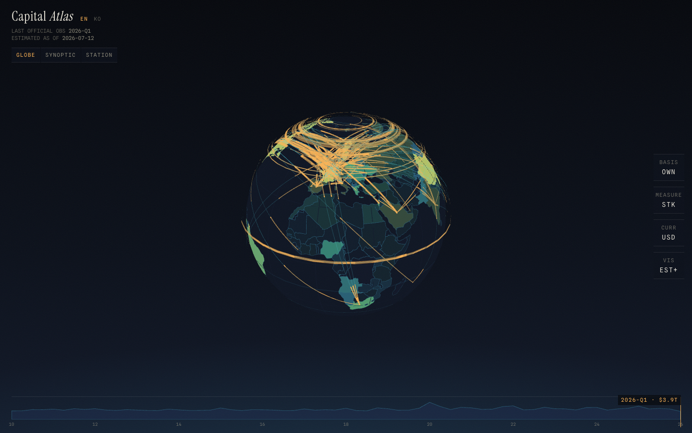

단일 관측 화면 위에 네 개의 계기만 떠 있다: 좌상 관측소 명판, 우측 계기 클러스터,
하단 바로그래프 타임라인, 그리고 국가를 클릭하면 우측에서 올라오는 관측 리포트.

| 관측 리포트 (국가 상세) | 계보 도시에 (교정 증명서) |
|---|---|
| 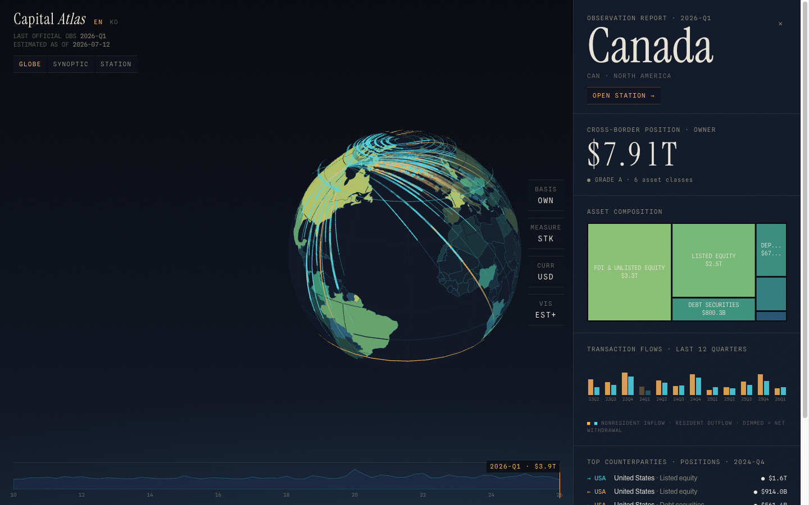 | 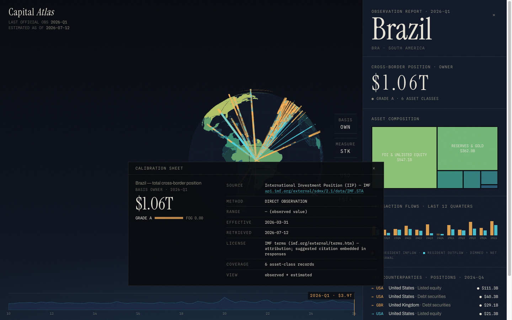 |

어떤 수치든 클릭하면 **계보 도시에**가 열린다 — 출처·산식·신뢰등급·범위의 의미
(95% 신뢰구간·민감도 범위·Fréchet 한계 등)·기준일.
계보 없는 숫자는 화면에 올리지 않는다.

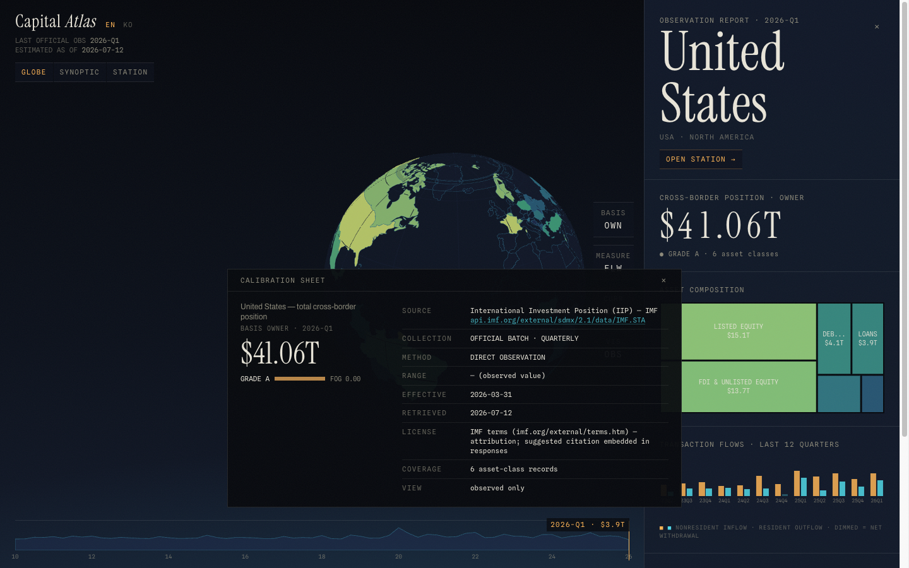

우측 **VIS 다이얼**을 `관측+추정 → 관측만`으로 돌리면 추정치(등급 C–E)가 화면에서
사라진다. 신뢰등급은 배지 이전에 **픽셀로 먼저** 말한다.

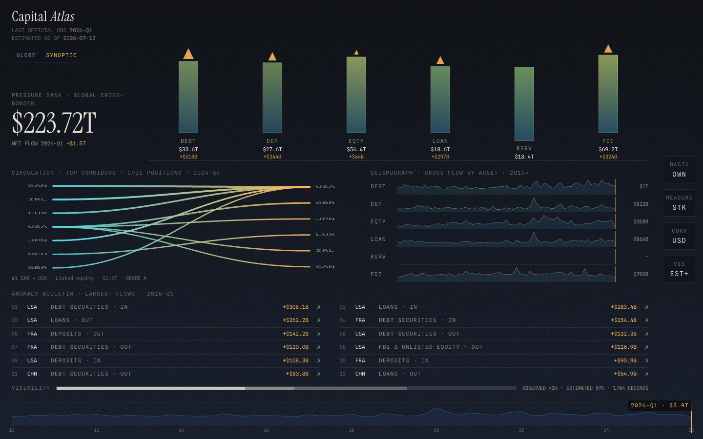

명판 아래 `GLOBE / SYNOPTIC / STATION` 토글로 **종관도**로 전환한다 — 모든 자산군의 잔액·
흐름·평가변동·최대 회랑·이상 관측을 한 화면에 놓은 기상청식 대시보드. 자산
기압계 칼럼(높이=글로벌 잔액, 니들=분기 순흐름), owner→issuer 순환도(cyan 유출→
amber 유입), 자산별 분기 지진계 스트립, 이상 관측 특보, 그리고 하단 시정 바가
"이 화면이 몇 %의 관측 위에 서 있는가"를 항상 밝힌다. 카드·KPI 타일은 여기에도
없다 — 전부 계기와 특보 조판이고, 어떤 숫자든 클릭하면 교정 시트가 열리며,
바로그래프 스크럽·자산 필터·VIS(관측만) 다이얼이 전 구역에 동시 반영된다.

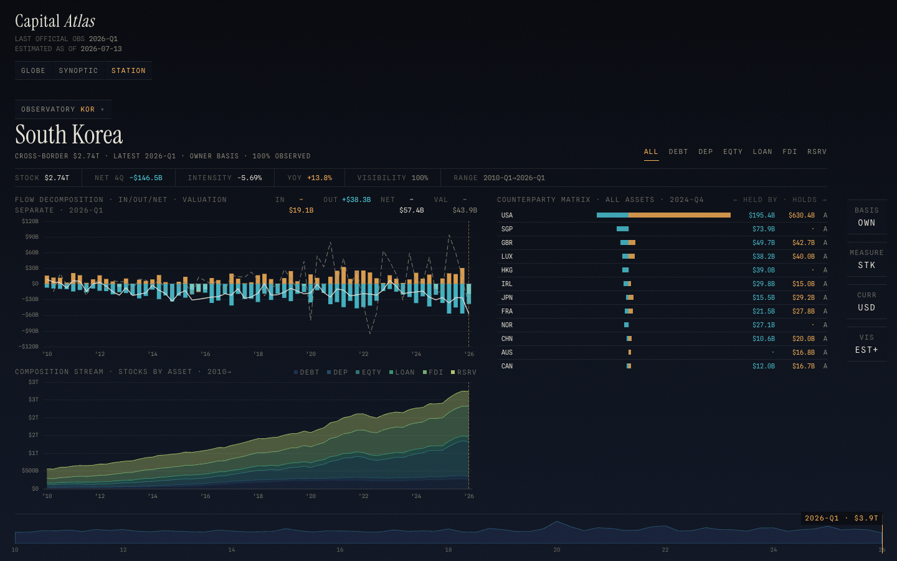

세 번째 표면 **STATION**은 유동 판단용 분석 콘솔이다. `OBSERVATORY` 다이얼로
국가를 필터하고(WORLD=세계 집계, 지구본의 국가 선택과 양방향 동기화), 자산 탭으로
상세에 진입한다. 주 차트는 **흐름 분해** — 유입(amber ↑)과 유출(cyan ↓)의 분기
발산 바 + 순흐름 라인 위에, 평가변동은 **별도 파선 층**으로만 겹친다(시가 변동을
자금 유입이라 부르지 않는다는 제품 원칙의 차트 형태). 자산 탭에서는 잔액 궤적에
**D/E 신뢰구간 밴드**가 그려지고(불확실성이 차트 위에 있다), PIP·DIP·BIS 상대국
매트릭스(← 피보유 · 보유 →)와 기저 레코드 원장이 따라온다. 계기 스트립의 흐름
강도(순유입/평균잔액)·YoY·시정 게이지까지 — 모든 숫자는 클릭하면 교정 시트다.

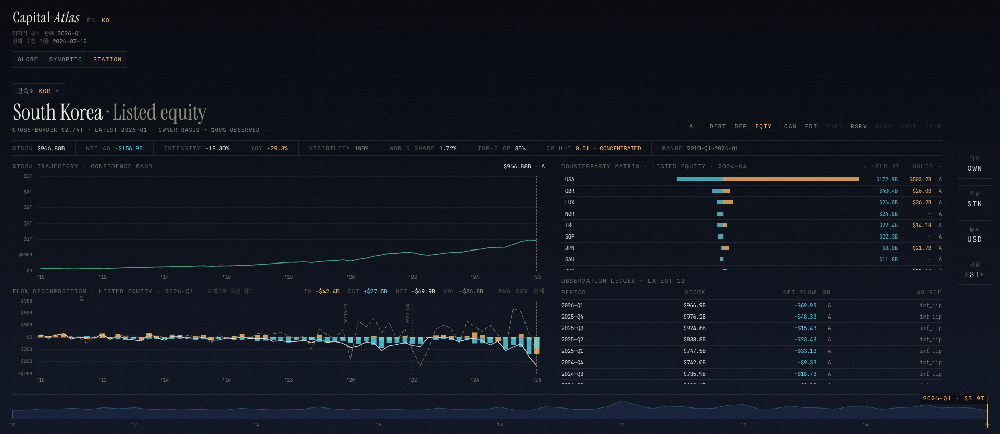

---

## 스택

- **React 19** + **React Compiler 1.0** (필수 — `babel-plugin-react-compiler`, rolldown babel 브리지)
- **Vite 8** (rolldown) · **TypeScript** strict
- **deck.gl 9** `_GlobeView` — 지구본 choropleth + `TripsLayer` 입자류(대권항로)
- **ECharts 6** — 자산 구성 트리맵
- **Tailwind v4** (`@theme` 토큰, 정본은 `DESIGN.md` §2) · **zustand** 상태
- 폰트: Instrument Serif · Archivo · Spline Sans Mono (`@fontsource` 셀프호스트)
- 데이터 파이프라인: `tsx` 오프라인 스크립트 + `zod` 게이트

서버·DB·크롤러 없음. 공개 통계를 오프라인에서 정적 JSON으로 구워
(`public/data/`) 그 위에 대시보드만 얹는다.

## 실행

```bash
pnpm i
pnpm dev            # Vite dev 서버 → http://localhost:5173

# 데이터 파이프라인 (선택 — 스냅샷은 이미 public/data/에 커밋돼 있음)
# 재수집 시 아래 순서 전체를 실행해야 파생 파일이 샤드와 정합한다.
pnpm data:fetch     # ① 공개 API 수집(24h 캐시) + 조립 → public/data/ 샤드 (환율 포함)
pnpm data:fx        # ①-b (선택) 환율만 단독 재수집 — data:fetch에 이미 포함
pnpm data:bis       # ② BIS 은행 회랑 재병합 (assemble이 bilateral을 재생성하므로 필수)
pnpm data:exposure  # ③ 통화·부문 직접 관측 + FXD·재구성 부채 발행 (네트워크 없음)
pnpm data:closure   # ④ IIP 마진↔raw normalized PIP seed RAS 폐합 발행 (네트워크 없음)
pnpm data:synoptic  # ⑤ SYNOPTIC 사전 집계 재생성 (커밋된 샤드에서, 네트워크 없음)
pnpm data:station   # ⑥ STATION 국가별 집계 + 집중도(§14) 재생성 (네트워크 없음)
pnpm data:flowmatrix # ⑦ 자산 간 재배분 행렬(§8, 모델 배분) 재생성 (네트워크 없음)
pnpm data:facts     # ⑧ 정본 수치 원장 facts.ndjson.gz 재발행 (네트워크 없음)
pnpm data:reconcile # ⑨ BIS 미러 폐합(§12-3) 재계산 (네트워크 없음)
pnpm data:sources   # ⑩ meta/sources.json 재발행 (retrieved_at 보존)
pnpm data:check     # ⑪ 계약·상식·사실원장·미러·RAS 정합 게이트
pnpm data:changed   # ⑫ 실질 변경 vs 타임스탬프-전용 분류 (커밋 게이트)
pnpm data:vintage   # ⑬ 실질 변경 시 빈티지 다이제스트 보존 (개정 이력의 원천)

# 검증
pnpm typecheck      # tsc -b
pnpm lint           # eslint (react-hooks v7 = React Compiler 규칙)
pnpm build          # tsc -b && vite build
```

`data:fetch`가 굽는 원시 응답은 `data-raw/`(gitignore)에 보존되고 24h 내 재사용된다.
파이프라인 상세는 [`docs/DATA_PIPELINE.md`](./docs/DATA_PIPELINE.md),
데이터 계약(정본)은 [`docs/DATA_CONTRACT.md`](./docs/DATA_CONTRACT.md).

### 결정론·빈티지·개정 이력 (Phase N — 초안 §10 이중 시간)

- **샤드는 결정론적이다**: 개별 샤드/파생 파일에 타임스탬프가 없다 — 같은 상류
  데이터면 같은 바이트(결정론 digest 테스트로 강제). 데이터 빈티지는
  `index.json generated_at`이 유일 정본(명판 "추정 기준"의 근거).
- **일일 크론은 실질 변경일 때만 커밋한다**: `data:changed`가 타임스탬프-전용
  변경(index.generated_at·sources.retrieved_at)과 실질 변경을 구분 — 데이터가
  안 바뀐 날은 커밋·배포가 발생하지 않는다(레포 비대화 방지).
- **실질 변경 커밋마다 빈티지 다이제스트**(`public/data/vintages/{날짜}.json`)를
  보존한다: (basis·국가·자산) 최신분기 값+등급, 국가 총계, 글로벌
  요약. IMF/WB의 소급 개정은 계보 도시에의 **REVISIONS** 행이 이 다이제스트와
  현재 값을 대조해 이전값→현재값·변화율 형식으로 노출한다.
  아직 개정이 관측되지 않았으면 "no revisions since {최초 빈티지}"로 정직 표기.
- **스크린샷 정책**: 문서 스크린샷의 명판 날짜는 촬영 시점의 데이터 빈티지다.
  일일 크론 운영상 날짜-단독 드리프트는 정상이며 재촬영 사유가 아니다.

### 데이터 다운로드 — 정본 수치 원장 (v3, §16-6)

관측과 명시적으로 등급화한 파생 수치를 단일 NDJSON 원장으로 내려받을 수 있다.
현재 레코드 수와 압축 바이트는 갱신 때 함께 생성되는
[`meta/facts_summary.json`](https://ca.yanghapark.com/data/meta/facts_summary.json)이 정본이다:

```
https://ca.yanghapark.com/data/facts.ndjson.gz   (gzip, 라인당 JSON 1개)
```

| 필드 | 의미 |
|---|---|
| `table` | `stocks` \| `flows_country` \| `flows_bilateral` \| `currency_exposure` \| `sector_positions` \| `reconstructed_liabilities` \| `constant_fx` \| `position_closure` |
| `basis` | stocks 전용 — `owner` \| `issuer` \| `location` |
| `country` / `owner_country`·`issuer_country` | ISO3 (테이블별) |
| `asset` · `period` · `measure` · `entry` | 자산군 · `YYYY-Qn` · stock/flow/valuation · BPM6 측 |
| `value_usd` | USD 절대값 (스케일 접미사 없음) |
| `source_id` · `effective_date` · `confidence_grade` | lineage — `meta/sources.json`으로 해석 |
| `estimate_method` · `lower_bound` · `upper_bound` | 파생·모델 수치에 적용(범위 의미는 레코드별 산식 참조) |

관측(A/B)과 파생(C–E)을 같은 원장에서 조회할 수 있지만 `confidence_grade`와
`estimate_method`를 지우고 소비하면 안 된다. synoptic/station/flowmatrix 같은 UI 집계는
재계산 가능한 2차 뷰라 포함하지 않는다. 정합은 `pnpm data:check`가 강제한다
(레코드 수·테이블·등급 분포 = 발행 샤드 합).
**재배포 주의**: 원 데이터는 IMF terms(attribution)·World Bank CC BY-4.0·BIS
terms를 따른다 — 이 파일을 재배포할 때 원 출처 표기를 유지하라(`meta/sources.json`
의 license_note가 소스별 정본).

### 미러 폐합 — §12-3 (Phase P)

BIS LBS는 같은 포지션을 두 나라가 각자 보고한다(A국 보고 claims vs B국 보고
liabilities). `meta/reconciliation.json`(분포 요약)과 `reconciliation/{분기}.json`
(쌍 상세)이 그 gap을 **조정 없이 기록**하고, 은행 양자 수치의 계보 도시에에
**MIRROR** 행으로 노출된다. 현재 쌍별 값은 `reconciliation/{분기}.json`, 분포는
`meta/reconciliation.json`이 정본이다. gap은 상대국 부문 커버리지 차이와 실제
불일치가 섞일 수 있다. PIP/CPIS에는 독립적인 양방향 직접
부채 보고가 없어 BIS식 미러는 불가능하다. v3의 `reconstructed_liabilities`는
상대국 자산을 전치한 C등급 재구성일 뿐, 독립 미러 관측으로 부르지 않는다.

## 데이터 소스

| source | 데이터 | 등급 | 라이선스 |
|---|---|---|---|
| **IMF IIP** | 대외 자산·부채 잔액, 국가×분기 (2010~) | A | IMF terms — attribution |
| **IMF BOP** | 금융계정 실거래 흐름 (바로그래프 실루엣) | A | IMF terms — attribution |
| **IMF IIPCC** | 대외채권·채무 통화구성 (가용 보고국 직접 관측) | A | IMF terms — attribution |
| **IMF PIP** (CPIS 후속) | 양자 포트폴리오 자산·보고 부문 (직접 관측) + SCC 파생 부채 | A / C | IMF terms — attribution |
| **IMF DIP** (CDIS 후속) | 양자 outward 직접투자 포지션 (직접보고·방향원칙) | A | IMF terms — attribution |
| **BIS LBS** | 국경 간 은행 loans&deposits 양자 회랑 (분기, Phase M) | B | BIS terms — attribution |
| **World Bank WDI** | 상장주식 시총(발행국 총액)·GDP | B | CC BY-4.0 |
| **CoinGecko** | 암호자산 글로벌 통제값 + 분리된 일중 오버레이 | B | free API — attribution |
| 내부 폴백 모델 | 롤포워드 / 지역-중앙값 GDP비율 / 주택자산 | D–E | internal estimate, ±20~35% |

신 IMF API(`api.imf.org/external/sdmx/2.1`, SDMX XML)와 BIS Data Portal API
(`stats.bis.org/api/v2`, SDMX-CSV)에서 수집. BIS 채무증권(DSS)은 후속.
최신 관측 분기와 소스별 기간은 `index.json`과 각 레코드 `effective_date`가 정본이다.
명판의 "추정 기준" 날짜는 데이터 스냅샷 빈티지(`index.generated_at`)다.

스냅샷마다 바뀌는 국가·기간·수치·바이트 수는 `index.json`,
`meta/facts_summary.json`, `meta/pipeline_report.json`이 정본이다. README에 현재값을
복제하지 않는다. 브라우저 샤드는 5MB 계약 게이트를 통과한 것만 발행하고 전부
lazy-load한다. 은행 회랑 갱신:
`pnpm data:bis`(멱등).

## 신뢰등급 A–E와 안개 렌더링

모든 수치 레코드는 lineage(출처·기준일·등급·산식·범위)를 갖는다. 등급은
**시정(視程)** 으로 번역된다 — 선명할수록 관측, 흐릴수록 추정 (`DESIGN.md` §6):

| 등급 | 의미 | 캔버스 | 패널 |
|---|---|---|---|
| **A** | 공식 직접 관측 | 연속 입자·실선, 안개 0 | 수치 단독 |
| **B** | 비공식 직접 관측 | 연속 입자, 미세 그레인 | 수치 + 등급 마크 |
| **C** | 파생·조정 | 파선 입자 | 수치 + 등급 마크 |
| **D** | 통계 모델 추정 | 파선 입자 + 안개 | 수치 + **범위 병기** |
| **E** | 저신뢰 잔차 추정 | 희박 입자 + 짙은 안개 | 범위가 주인공 |

안개 알파는 `--fog-A:0 … --fog-E:0.45`. 국가 색은 값-가중 평균 등급만큼 잉크로
흐려지고, 트리맵·상대국 리스트·계보 도시에도 같은 규칙을 따른다. 현재 스냅샷의
정확한 등급 분포는 `meta/facts_summary.json.by_grade`가 정본이다.

## 계기 사용법

- **국가 클릭** → 우측 관측 리포트(잔액·자산 트리맵·분기별 BOP 흐름·상위 상대국).
- **수치 클릭** → 하단 계보 도시에(교정 증명서).
- **BASIS** 다이얼: 소유자(OWN) / 발행자(ISS) / 소재지(LOC) — 국가 귀속 기준 분리.
- **MEASURE** 다이얼: 잔액(STK) / 흐름(FLW) / 평가변동(VAL) / 거래량(TRN).
- **VIS** 다이얼: 관측+추정(EST+) / 관측만(OBS).
- **바로그래프**: 하단 area 실루엣이 곧 슬라이더 — 스크럽하면 분기가 바뀐다(키보드 ← →).

모든 계기는 키보드 조작 가능하고, `prefers-reduced-motion` 시 입자류는 정적
스트림라인으로 대체된다(예외가 아니라 대체).

## i18n · 딥링크 · 브러시 (Phase G)

- **로케일 ko/en**: 명판 옆 `KO / EN` 토글. 경계 — **계기 코드는 로케일 불변**
  (OWN/STK/EST+/자산 약어/등급 A–E/ISO3/분기 키/뷰 코드), 섹션 프로즈·툴팁·
  빈 상태·도시에 행 라벨·aria만 번역. 숫자는 2구역: 축·리드아웃 `$223.72T`
  mono 불변, 프로즈는 Intl 위임(ko 조/억 그룹핑 — 하드코딩 금지).
  대문자 mono 섹션 헤더(FLOW DECOMPOSITION 등)는 계기 언어로 간주해 EN 유지.
- **URL 딥링크**: `?view=&country=&asset=&period=&basis=&measure=&vis=&lang=` —
  공유·새로고침 시 상태 복원, 기본값은 생략. 잘못된 값은 조용히 드랍.
- **기간 브러시**(STATION 흐름 차트): 수평 드래그 = 구간 확대, `RESET RANGE`로
  복귀. 클릭 스크럽은 그대로.
- **이벤트 주석**: 2011-Q3 유로위기 · 2020-Q1 COVID-19 · 2022-Q1 긴축 세로 마커.
- **회색+사유**: 데이터 없는 자산 탭은 숨기지 않고 회색 처리, hover에 사유.
- **연결 하이라이트**(SYNOPTIC): 기압계 hover 시 지진계·특보가 같은 자산을 동조.
- **디자인 토큰 SSOT**: 색은 `index.css @theme`가 유일 원천 — TS/차트는
  `lib/tokens.ts`(CSS 변수 런타임 판독 + 노드 폴백 미러, 드리프트 테스트가
  바이트 단위 정합 강제). hex-0 게이트가 회귀를 차단.

## CONCENTRATION — 자본 쏠림의 정량화 (Phase H)

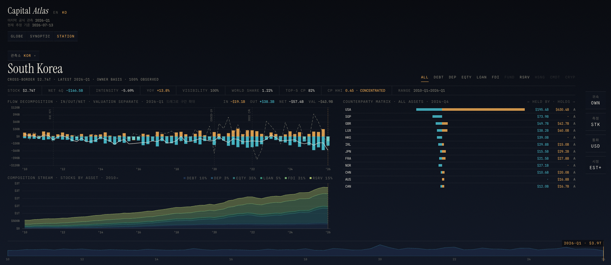

"자본 비중이 어디에 쏠렸나"를 %와 집중도 지표로 읽는다 (설계 §14):

- **STATION 계기 스트립**: `WORLD SHARE`(국가 잔액 ÷ 세계 총액 — 자산 탭이면 그
  자산의 세계 대비), `OBS STOCK`(현재 잔액 중 A/B 관측 비중), `CP ALLOC`(같은 기간의
  발행 bilateral gross ÷ owner 잔액), `TOP-5 CP`(상위 5 상대국 비중), `CP HHI`(허핀달-허시먼 지수
  + CONCENTRATED/MODERATE/DIVERSE 관용 구간 0.25/0.15). 전부 클릭 = 교정 증명서
  (산식·프루닝 한계·top-5 분해까지 그대로).
- all-scope 상대국은 `BILATERAL-COVERED ASSETS`로만 부른다. PIP(asset/liability),
  DIP(directional principle), BIS(position side)의 관측 범위와 basis가 다르므로
  `CP ALLOC`은 source completeness나 국가 총자산 폐합률이 아니다. exact-period
  분모가 없으면 보간하지 않고 unavailable 사유를 표시하며 100% 초과도 숨기지 않는다.
  등급은 양자 분자와 owner-stock 분모 중 낮은 쪽을 따르고, 분모 source와 D/E 범위도
  도시에 운반한다. OBS 모드에서는 D/E 분모로 계산한 배분비를 수치처럼 보이지 않는다.
- **HHI는 발행 bilateral 샤드 전체에서 사전 계산** — 화면의 top-15 리스트로
  계산하면 꼬리가 잘려 과대평가된다. 샤드 자체의 |값|≥$100M 프루닝 한계는 산식
  문구에 명시하며 현재 HHI·상위 상대국 비중은 station shard가 정본이다.
- **% 병기**: SYNOPTIC 기압계 칼럼(금액·비중)과 순환도 헤더
  (`TOP 20 = 29% OF GROSS`), COMPOSITION STREAM 범례(`EQTY 35%`), 자산 탭
  hover, 트리맵 hover. VIS=OBS면 전부 관측-한정 변형으로 전환.

## REALLOCATION — 자산 간 흐름 재배분 모델 (Phase O, §8)

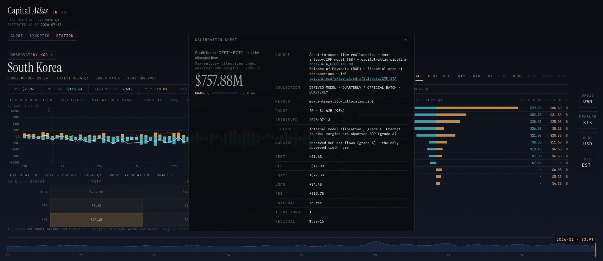

"채권에서 빠진 돈이 주식으로 갔는가?"에는 직접 관측이 존재하지 않는다.
STATION ALL 탭의 `REALLOC` 보기는 관측된 BOP 순흐름(A등급)을 마진 제약으로
하는 **최대엔트로피(IPF) 모델 배분**을 보여준다 — 매도(행)→매수(열) 행렬,
수지 차액은 `EXT`(신규 자금/순회수) 노드가 흡수해 항상 폐합한다.

- **전 셀 grade E** — 구역 전체가 E-안개이고 "MODEL ALLOCATION · GRADE E"가
  상시 표기된다. **VIS=OBS로 돌리면 구역이 통째로 사라진다**(전부 모델이므로 —
  §6 안개 계약의 가장 순수한 적용).
- 셀 클릭 = 교정 시트: 산식(`max_entropy_flow_allocation_ipf`), **Fréchet 한계**
  (가정 없는 원리적 범위 — `max(0,r+c−T) ≤ F ≤ min(r,c)`), 반복·잔차, 관측 마진.
- **흐름 부문 축**은 BOP 집계에 없어 생략 — v3의 PIP 포지션 부문 관측과는
  별개의 제약이다. 가계·기업·정부를 추정 분해해 행렬을 채우지 않는다.

### 내보내기 · 팔레트 · 튜토리얼 (Phase I — UX 백로그 완주, 잔여 0)

리서치 백로그 전량 적용:

- **PNG/CSV 내보내기** (P2-10): STATION 흐름 분해·구성 스트림, SYNOPTIC 지진계의
  `PNG · CSV` 미니 계기. PNG는 하단에 **출처 표기 스트립을 자동 합성** — IMF
  attribution·World Bank CC BY-4.0 표기 의무가 파일 안에서 이행된다. CSV는
  `# Source/Grade/Generated` 메타 주석 + RFC4180, 파일명
  `capital-atlas_{국가}_{자산}_{분기}.csv`. 전부 로컬 Blob — 외부 요청 없음.
- **커맨드 팔레트** (P2-11): `Cmd/Ctrl+K`. 계기 코드가 곧 명령어 —
  `KOR EQTY`(한국 상장주식 STATION 점프), `2018-Q1`, `OBS`, `ISS`, `SYNOPTIC`,
  한글 국가명(`미국 EQTY`)·`TUTORIAL` 지원. 최근 명령 상단, 완전 키보드.
- **풀스크린 차트** (P3-15): 흐름 분해·구성 스트림의 `전체/FULL` — 브러시·
  크로스헤어·범례·바로그래프 유지, Esc 복귀.
- **첫 방문 튜토리얼** (P3-16): 4단계 계기 안내(1회, `atlas.tutorial.v1`),
  팔레트 `TUTORIAL`로 재호출.
- **Small multiples** (P3-17): STATION ALL 탭 `STREAM / MULTIPLES` 전환 —
  자산별 미니 흐름 격자, 공유 y-스케일 기본, 셀 클릭 = 자산 탭 진입.

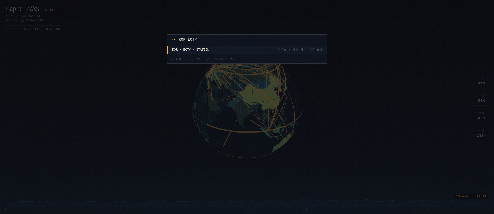

| 첫 방문 튜토리얼 | Small multiples |
|---|---|
| 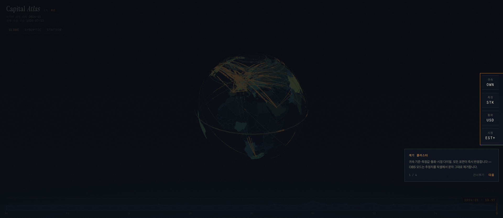 | 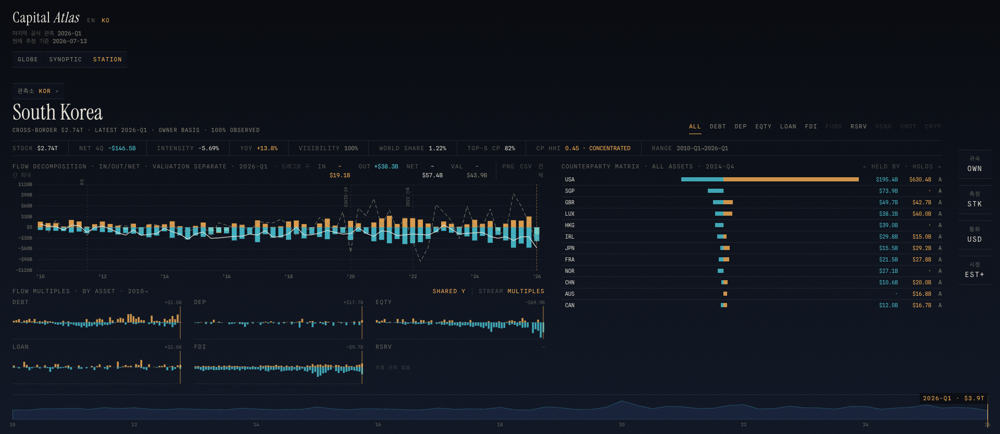 |

## 알려진 한계 (v3 — 의도된 결정)

- **거래량(TRN) = 빈 캔버스.** v1엔 turnover(난류) 관측이 없다. 허위로 채우지 않고
  정직하게 비운다("NO TURNOVER OBSERVATIONS"). 파생 채움은 v2.
- **소재지(LOC) basis = 짙은 안개.** 주거부동산은 지역별 주택자산/GDP 배율 휴리스틱
  (E등급, 연 Q4만). 등기·센서스 기반은 v2 — 짙은 안개가 그 저신뢰를 정직하게 말한다.
- **계보 도시에 = 열린 시점의 스냅샷.** 도시에는 클릭 당시의 basis/period/VIS 상태를
  고정 캡처한다. 이후 계기를 바꿔도 열린 도시에는 갱신되지 않는다(닫고 다시 연다).
- **통화(CURR) 다이얼 = USD | LCU (Phase L).** LCU는 선택 국가의 현지통화로 분기
  기말 환율(IMF ER A등급 · WB 연간 Q4 폴백 B등급)을 곱한 정확 산술. 현재 국가별
  커버리지와 source는 `meta/fx_rates.json`이 정본이다.
  국가 스코프(STATION 국가 선택·GLOBE 리포트)에서만 활성 — 글로벌 집계는 통화 합산이
  무의미해 다이얼이 회색+사유("MIXED CURRENCIES — USD ONLY")가 된다. LCU 표시 수치의
  도시에엔 FX RATE·LCU/USD VALUE 행이 병기된다. v3 **고정환율 USD(FXD)**는
  `exposure/`에 별도 발행한다(기준 2020-Q4). IIPCC 직접 통화구성의 보고 범위가
  제한적이므로 `OTHC+UALLC>5%`, 환율 누락, 통화합↔총계 gap>0.5%면 숫자 대신 정확한
  unavailable 사유를 보인다. `XDC`는 국가 ISO 통화의 currency-level IMF 환율
  중앙값(WB 폴백)을 쓰며 실제 환율 source까지 dossier에 남긴다. 핵심 `stocks`의
  `value_usd_constant_fx`는 관측 원장을
  덮어쓰지 않기 위해 계속 미산출이다. CSV/PNG 내보내기는 LCU 모드에서도 **USD 원값**을
  수출한다(계보 정본 유지 — 환율은 도시에 FX RATE 행으로 추적).
- **부문은 보고된 코드만 노출한다.** PIP 직접 포지션의 S11(비금융기업), S13(정부),
  S14(가계) 등은 A등급이지만 S1V(비금융기업·가계·NPISH 결합군)는 그대로 둔다.
  결합군을 가계/기업으로 임의 배분하지 않으며, BOP 흐름에는 아직 부문 축이 없다.
- **RAS 정적 샤드는 leading cells만 발행한다.** 전체 행렬로 마진을 닫은 뒤 자산별
  상위 1,000셀만 저장하며, 생략 셀 수·합계를 샤드와 도시에에 명시한다. 선택 국가가
  tail에만 있을 때 “모델 없음”으로 속이지 않고 발행 tail 생략 사유를 표시한다.
- **실시간 가격은 공식 빈티지를 바꾸지 않는다.** 화면 상단 CoinGecko 글로벌 암호자산
  시총만 `LIVE MARKET · NOT OFFICIAL STATISTICS · B`로 분리해 최대 12회, 5분 간격으로
  갱신한다. 국가 배분·공식 지수에는 사용하지 않고 실패·오래된 응답은 정적 스냅샷으로
  명시적으로 폴백한다.
- **극지 통과 입자류.** 대권항로가 극점 부근을 지날 때의 스파이크는 고도를 극지에서
  0으로 테이퍼링해 크게 완화했으나, 북극 상공 흐름 밀집 구간엔 잔여 번들이 남는다.
- **번들 청크.** deck.gl/echarts를 별도 청크로 분리했지만 두 라이브러리 청크는
  500KB 경고 대상이다. 현재 크기는 `pnpm build` 출력이 정본이며 내부 분할은 v2 리스크다.
- **데이터 정밀도 한계**(파이프라인 상세): IIP `P_F5`에 펀드지분 포함 →`funds` 미분리 ·
  PIP 파생 포지션 변화는 가격효과 미조정(D등급, 실제 거래 흐름이 아님) · DIP 방향원칙과 IIP 자산/부채 원칙의
  통계적 basis 차이 · 양자 레코드 |값| < $100M 프루닝
  (드롭 수는 `meta/pipeline_report.json`에 기록; 가치 보존율은 별도 주장하지 않음).

## 결정 기록

- **2026-07-13 · "현재 추정 기준" = 데이터 스냅샷 빈티지.** 명판의 ESTIMATED AS OF를
  월클럭(`new Date()`)에서 `index.generated_at`으로 변경(독립 감사 F1). v1은 나우캐스팅
  없는 정적 스냅샷 — 오늘 날짜 표시는 보유하지 않은 신선도 주장이다. 나우캐스팅 도입
  시점에 재검토.
- **2026-07-14 · 실시간 오버레이는 공식 통계와 분리.** 공개 CORS 시장값 하나만
  제한적으로 갱신하며, 수집시각·B등급·비공식 라벨·스냅샷 폴백을 한 픽셀에 묶었다.
  이 값은 `index.generated_at`, 국가별 수치, 공식 통계 계산을 절대 변경하지 않는다.
- **2026-07-14 · 상대국 배분은 범위와 통계 basis를 함께 표시.** PIP 반기 관측과
  IMF DIP outward 포지션을 추가하되 PIP·DIP·BIS를 단일 완전 장부로 부르지 않는다.
  STATION은 `OBS STOCK`과 exact-period `CP ALLOC`을 분리하고, 수치·도시에·원장에
  source family와 position basis를 보존한다.

## 재검토 후보 (v3 이후 — 자세히는 `docs/architecture.md`)

- **BIS·부동산·암호자산 심화**: 채무증권 발행잔액(BIS DSS), 등기/센서스 기반 주택자산,
  국가별 암호자산 배분.
- **자산 간 흐름 행렬**: 소유자↔발행자↔소재지 3장부를 잇는 룩스루(펀드·ETF·SPV·토큰).
- **직접 통화·부채 커버리지 확대**: IIPCC 비보고국의 구성을 추정으로 메우지 않는다.
  PIP SCC 재구성(C)은 독립 CPIS 부채 미러가 아니므로 직접 양방향 보고가 생길 때 재검토한다.
- **부문 심화**: 직접 보고된 가계/기업/정부 포지션은 노출했지만, BOP 흐름 부문과
  결합군 분해는 원자료가 생길 때만 도입한다.
- **가격 오버레이 확대**: 현재는 글로벌 암호자산 시총 하나뿐이다. 인증·요율 제한이
  있는 다자산/국가별 feed는 정적 아키텍처 재검토 조건을 먼저 충족해야 한다.
- **엔진화**: 사실 원장 gzip 100 MB 또는 단일 서빙 샤드 5 MB 초과, 일중 국가별
  관측 도입 시 DuckDB/서버 계층을 재검토한다.

## 문서

- [`BRIEF.md`](./BRIEF.md) — 프로젝트 브리프 · 제품 원칙 10개
- [`DESIGN.md`](./DESIGN.md) — 시각 디자인 정본(BAROMETER) · §1 불변 원칙 5개
- [`docs/DATA_CONTRACT.md`](./docs/DATA_CONTRACT.md) — 데이터 계약(정본, TS 미러 `src/types/data.ts`)
- [`docs/DATA_PIPELINE.md`](./docs/DATA_PIPELINE.md) — 수집·조립·폴백 사다리·프루닝
